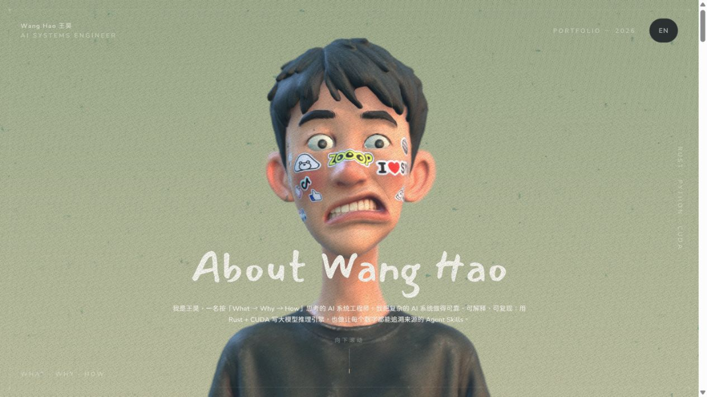

<h1 align="center">Wang Hao · 3D Résumé</h1>

<p align="center"><b>滚动即运镜的 3D 个人简历与作品集。</b></p>

<p align="center">
  <a href="https://me.redheartsecretman.top/">在线访问</a> ·
  <a href="https://github.com/RedHeartSecretMan">GitHub</a> ·
  <a href="README.en.md">English</a>
</p>

<p align="center">
  <a href="https://me.redheartsecretman.top/"></a>
</p>

我是王昊，一名 AI 系统工程师，按「What → Why → How」思考问题。这个网页把履历放进一个 3D 场景里：向下滚动时，镜头依次推到每段经历，最后进入作品画廊。

## 内容

| 部分 | 内容 |
| --- | --- |
| About | AI 系统工程师，关注可靠、可解释、可复现的 AI 系统 |
| 履历 | 学习笔记 → go_subtitle → 视觉与本地大模型工具 → vllm-oxide → Agent Skills |
| 作品 | 推理系统、Agent Skills、音视频工具、视觉与笔记四个板块 |

代表项目：

- [vllm-oxide](https://github.com/RedHeartSecretMan/vllm-oxide)：Rust + CUDA 大模型推理引擎
- [a-share-research-skill](https://github.com/RedHeartSecretMan/a-share-research-skill)：证据优先的 A 股研究 Skill
- [dag-skill](https://github.com/RedHeartSecretMan/dag-skill)：多 Agent 协同执行 Spec-and-Ticket DAG
- [go_subtitle](https://github.com/RedHeartSecretMan/go_subtitle)：音视频字幕生成工具（PyPI）

## 本地运行

前端应用在 [`web/`](web) 下，需要 Node.js 20+。

```bash
cd web
npm install
npm run dev        # http://localhost:5173
npm run build      # 类型检查 + 打包到 dist/
```

## 修改内容

路径相对 `web/`：

| 内容 | 文件 |
| --- | --- |
| 首屏介绍与角标 | `src/App.tsx` |
| 履历时间轴 | `src/ui/Resume.tsx` |
| 作品画廊 | `src/data/works.ts` |
| 作品详情 | `src/content/works/<slug>.md` |
| 镜头停靠点 | `src/data/focusPoints.ts`（数量须与履历条数一致） |
| 灯光、景深、背景等画面参数 | `src/scene/Scene.tsx` 各组件顶部的常量 |

## 模型与教程

| 资源 | 用途 |
| --- | --- |
| [`blender/wanghao.blend`](blender/wanghao.blend) | 3D 人物、贴纸与镜头动画源文件，导出为 `web/public/models/me.glb` |
| [`tutor/intro3d处理模型教程`](tutor/intro3d处理模型教程/intro3d处理模型教程.md) | 生成并处理人物模型 |
| [`tutor/眼球教程`](tutor/眼球教程/眼球教程.md) | 制作可跟随鼠标的眼球 |
| [`tutor/贴纸教程`](tutor/贴纸教程/贴纸教程.md) | 用 AI 生成脸部与场景贴纸 |
| [`tutor/部署教程`](tutor/部署教程) | GitHub Pages / Cloudflare Pages 部署 |
| [`web/src/content/works/example.md`](web/src/content/works/example.md) | 作品详情页写法示例 |
| [`README.en.md`](README.en.md) | 英文说明 |

替换模型时需保留 `CameraAction`、`focus-0` 到 `focus-5`、`focus-works` 与名称含 `eye` 的网格，否则运镜和眼球跟随会失效。

## 部署

部署工作流 [`.github/workflows/deploy.yml`](.github/workflows/deploy.yml) 监听 `main` 推送，也支持手动触发；它构建 `web/` 并发布到 GitHub Pages。`vite.config.ts` 使用 `base: './'`，产物也可以放到任意静态托管或子目录。

- 本仓库 `redheartsecretman-resume` 维护简历内容，访问地址为 <https://me.redheartsecretman.top/>。
- [redheartsecretman-landing](https://github.com/RedHeartSecretMan/redheartsecretman-landing) 提供 <https://redheartsecretman.top/> 的个人网站入口。
- 简历域名在仓库 **Settings → Pages → Custom domain** 中配置；Actions 部署使用该设置。两个仓库分别发布，修改简历无需修改根域名跳转页。

推送后请在 **Actions** 核对运行对应本次提交，不能只看较早的成功记录。若未生成部署任务，可在 **Deploy to GitHub Pages → Run workflow** 选择 `main`，或运行：

```bash
gh workflow run deploy.yml --ref main -R RedHeartSecretMan/redheartsecretman-resume
```

## 技术栈

React 18 · TypeScript · @react-three/fiber · @react-three/drei · @react-three/postprocessing · three · framer-motion · zustand · Vite

## 许可

代码采用 [MIT](LICENSE)。简历与作品文案、第三方素材的说明见 [`NOTICE`](NOTICE)。
